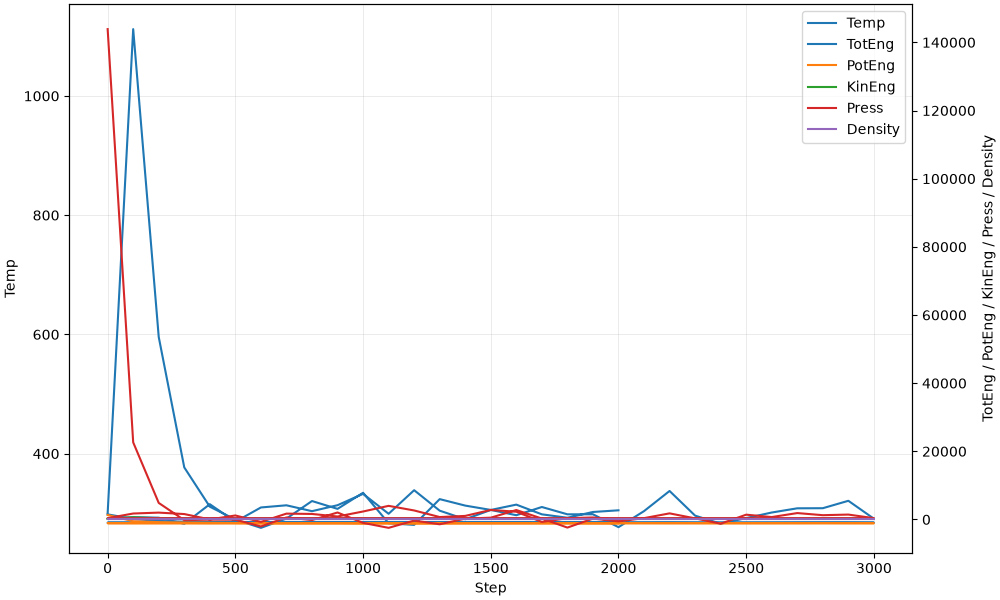
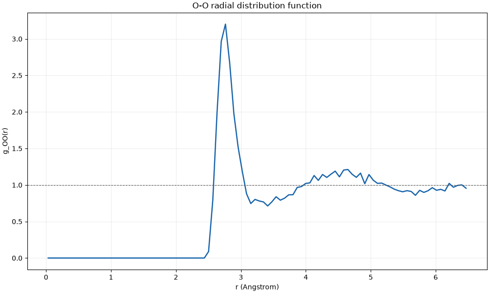

# IamLAMMPS

[](https://github.com/JinZongxiao/IamLammps/actions/workflows/ci.yml)
[](https://www.python.org/)
[](#system-requirements)
[](LICENSE)

基于 OpenAI Agents SDK 的 LAMMPS 终端模拟编程 Agent。

A terminal simulation coding agent for LAMMPS, built on the OpenAI Agents SDK.

[中文](#zh-cn) | [English](#english)


<a id="zh-cn"></a>

## 中文

快速导航：

- [项目简介](#zh-overview)
- [系统要求](#zh-requirements)
- [完整安装教程](#zh-installation)
- [基本使用流程](#zh-usage)
- [SPC/E 运行到画图](#zh-tutorial)
- [审批、Analyzers 与 MCP](#zh-controls)
- [故障排查与开发](#zh-maintenance)

<a id="zh-overview"></a>

### 项目简介

IamLAMMPS 将自然语言对话、受控文件编辑、LAMMPS 执行和确定性后处理放在同一个
OpenAI Agents SDK 会话中。它适合搭建、检查、运行和分析本地 LAMMPS 教学或研究项目，
但不会替代势函数审查、统计收敛分析和领域专家判断。


核心能力：

- 在项目工作区内读取、创建和 CAS 更新文本文件；
- 在执行前验证 LAMMPS 输入并要求用户批准每次 LAMMPS 启动；
- 为每次运行创建独立且不覆盖的 execution 目录、输入快照和结构化 manifest；
- 使用明确的 `run_id` 检查运行、解析 thermo、运行 analyzers；
- 不依赖模型临时编写 Python，确定性生成 thermo 和 O-O RDF PNG；
- 搜索、校验并记录官方 LAMMPS potential 候选；
- 支持项目 Skill 指令和经过工具白名单约束的 stdio MCP；
- 对写入、进程、网络、超时、失败重试和每轮 Agent 行为设置边界。


<a id="zh-requirements"></a>

### 系统要求

| 项目 | 支持范围 |
| --- | --- |
| 操作系统 | macOS 或 Linux，POSIX 环境 |
| Python | 3.11、3.12、3.13 |
| LAMMPS | 本地可执行文件；SPC/E 样例需要 KSPACE、MOLECULE、RIGID |
| 模型提供方 | OpenAI Responses API 或 DeepSeek Chat Completions |

Windows 支持将在跨平台进程树终止和文件安全语义完成后恢复。不要以 root 用户运行
IamLAMMPS。在共享机器上应额外使用容器、调度器或操作系统级沙箱。

安全边界：

- 模型输出始终是不可信输入，必须经过类型、路径、脚本策略、预算和审批检查；
- Agent 没有通用 shell，但经批准的 `run_python_analysis` 会以当前用户权限访问主机；
- 审批是应用层 guardrail，不是 OS 沙箱；对不可信分析应限制挂载、网络、CPU、内存和进程；
- 只使用测试密钥做演示，生产密钥放在被忽略的 `.env` 中，并遵循最小权限原则；

<a id="zh-installation"></a>

### 完整安装教程

#### 1. 获取源码并创建虚拟环境


```bash
git clone https://github.com/JinZongxiao/IamLammps.git
cd IamLammps

python3 -m venv .venv
source .venv/bin/activate
python -m pip install --upgrade pip
python -m pip install .
```

开发者安装请使用：

```bash
python -m pip install -e '.[test]'
```

如果从 GitHub Release 下载了 wheel，也可以在激活虚拟环境后安装对应文件：

```bash
python -m pip install ./iamlammps-5.0.0-py3-none-any.whl
```

#### 2. 安装 LAMMPS

macOS/Homebrew 示例：

```bash
brew install lammps
command -v lmp_mpi || command -v lmp
```

Ubuntu/Debian 示例：

```bash
sudo apt-get update
sudo apt-get install lammps
command -v lmp || command -v lmp_mpi
```

不同发行版提供的 LAMMPS 版本和 package 可能不同。教学样例要求 `KSPACE`、`MOLECULE`
和 `RIGID`。最终以 `iamlammps doctor` 的检查结果为准。

`LAMMPS_COMMAND` 必须是单个可执行文件名或绝对路径，不要在其中附加命令行参数。
当 `MPI_NP` 大于 1 时，系统还需要可用的 `mpirun`。

#### 3. 初始化独立项目

模拟项目不必放在源码仓库中。推荐创建独立工作区：

```bash
iamlammps init ../iamlammps-demo
cd ../iamlammps-demo
cp .env.example .env
```

`iamlammps init [directory]` 从已安装包的 resources 复制模板，已有路径一律保留，不会
覆盖。初始化结果包括：

```text
.env.example
.iamlammps/
  mcp.example.json
  skills/
runs/
  spce-100/
    inputs/
      spce.in
      spce.mol
    reference/
```

`reference/*.csv` 只是 parser/plot 测试夹具，不是实跑结果、golden 物性或收敛基准。

#### 4. 配置模型和 LAMMPS

编辑项目根目录的 `.env`。交互程序只加载当前工作目录中的 `.env`，所以启动前必须先
`cd` 到项目目录。

OpenAI 配置示例：

```dotenv
LLM_PROVIDER=openai_agents
OPENAI_BASE_URL=https://api.openai.com/v1
OPENAI_API_KEY=replace-with-your-key
OPENAI_MODEL=your-responses-api-model
OPENAI_REASONING_EFFORT=medium
OPENAI_TRACING=false

LAMMPS_COMMAND=/absolute/path/to/lmp
# LAMMPS_TIMEOUT=600
# MPI_NP=4
ENABLED_ANALYZERS=thermo_tail,convergence,thermo_validator
```

DeepSeek 配置示例：

```dotenv
LLM_PROVIDER=deepseek
DEEPSEEK_BASE_URL=https://api.deepseek.com
DEEPSEEK_API_KEY=replace-with-your-key
DEEPSEEK_MODEL=deepseek-chat

LAMMPS_COMMAND=/absolute/path/to/lmp
# LAMMPS_TIMEOUT=600
# MPI_NP=4
ENABLED_ANALYZERS=thermo_tail,convergence,thermo_validator
```

不要提交 `.env`、`.iamlammps/mcp.json`、会话数据库或下载的凭据文件。

#### 5. 运行环境诊断

```bash
iamlammps doctor
```

完整环境应看到类似结果：

```text
[PASS] python
[PASS] workspace
[PASS] model configuration
[PASS] lammps executable
[PASS] lammps packages
[PASS] matplotlib
6/6 checks passed
```

`doctor` 不打印密钥，也不会联网验证模型密钥是否真实有效。它只确认配置字段非空并检查
本地依赖。

<a id="zh-usage"></a>

### 基本使用流程

在已经配置好的项目根目录启动：

```bash
iamlammps
```

`iamlammps` 没有 `run` 或 `plot` 子命令。运行和绘图是在 REPL 中通过自然语言触发的
受限工具调用。

常用 REPL 命令：

| 命令 | 作用 |
| --- | --- |
| `/mode ask` | 默认模式；对写入、执行和外部动作逐项询问 |
| `/mode auto` | 自动批准工作区编辑和本地 potential staging |
| `/mode read-only` | 拒绝所有副作用动作 |
| `/new` | 清空当前 SDK 会话上下文 |
| `/status` | 查看 provider、模式、LAMMPS、MPI、timeout、session |
| `/mcp` | 查看 configured/approved/active/failed MCP |
| `/skills` | 查看项目 Skill |
| `/help` | 查看帮助 |
| `/exit` | 退出并关闭模型、MCP 和 SQLite 资源 |

`/mode auto` 不会自动批准 LAMMPS、Python、网络、下载或 MCP。确定性 `plot_run` 是一个
例外：它只能写入所选 run 的 `artifacts/plots/`，不再申请额外批准。

<a id="zh-tutorial"></a>

### 完整 SPC/E 教学案例：运行到画图

初始化项目已经提供 `runs/spce-100/inputs/spce.in`。该输入使用：

- 100 个刚性 SPC/E 水分子，共 300 个原子；
- 固定随机种子和约 0.9977 g/cm3 的周期盒；
- SHAKE、LJ + long-range Coulomb、PPPM、1 fs 时间步；
- 3000 步 NVT，随后重置 timestep 并运行 2000 步 NVE；
- 在 NVE 阶段输出 100 bins 的 O-O RDF。

#### 1. 启动 Agent

```bash
cd /path/to/iamlammps-demo
iamlammps
```

#### 2. 输入教学请求

```text
请运行现有的 runs/spce-100/inputs/spce.in。成功后使用返回的同一个 run_id
检查运行结果，并调用 plot_run 生成 thermo 和 rdf_oo 两张图。
不要修改输入文件，不要使用自定义 Python，也不要使用 reference CSV 代替实跑数据。
```

#### 3. 审批 LAMMPS 启动

Agent 会展示输入路径、哈希、timeout 和 MPI 参数。确认无误后输入 `y`。每次 LAMMPS
启动都必须单独批准；如果拒绝，本轮所有后续副作用都会停止，Agent 不得更换路径或工具
再次申请。

审批文件动作时还应核对 create/update、目标路径、字节数和 SHA-256。执行完成后不要只看
模型总结，应检查结构化 status、return code、run_id 和 artifact directory。

#### 4. 检查结果和图片

本 README 的示例图片来自 2026-07-14 的一次真实本地运行，不是 reference CSV：

| 字段 | 实跑结果 |
| --- | --- |
| LAMMPS | 22 Jul 2025 Update 3，单进程 |
| run_id | `20260714T082210.928938Z-7d2a9b722972` |
| status / return code | `succeeded` / `0` |
| wall time | 2.92 s |
| input SHA-256 | `ceb5969aae155b81d3ad26060adc0184611ea3855ad9062151b8b6e7fadbe105` |
| thermo rows | 52 |
| O-O RDF | 100 bins；最大值约 `g(r)=3.20183` at `r=2.7625 A` |
| PNG | 两张均为 1000 x 600，且通过非空、可读取、非纯色检查 |

| Thermo 结果图 | O-O RDF 结果图 |
| --- | --- |
|  |  |

用户自己的图片位于：

```text
runs/spce-100/executions/<run_id>/artifacts/plots/thermo.png
runs/spce-100/executions/<run_id>/artifacts/plots/rdf_oo.png
```

macOS 和常见 Linux 桌面可以分别使用以下命令打开：

```bash
open runs/spce-100/executions/<run_id>/artifacts/plots/rdf_oo.png
# Linux: xdg-open runs/spce-100/executions/<run_id>/artifacts/plots/rdf_oo.png
```

#### 5. 理解产物目录

```text
runs/spce-100/
  inputs/
  executions/<run_id>/
    manifest.json
    stdout.log
    stderr.log
    workspace/
      spce.in
      spce.mol
      log.lammps
      rdf_oo.dat
    artifacts/plots/
      thermo.png
      rdf_oo.png
  latest.json
```

后续运行不会覆盖之前的 execution。`latest.json` 只是最近一次尝试的指针，不保证该次
尝试成功；分析时应使用工具返回的明确 `run_id`，并检查 `manifest.json`、status、
return code、stdout 和 stderr。

模型可见的通用写工具会拒绝修改 `executions/**` 和 `latest.json`。确定性绘图只能通过
专用 `plot_run` 写入当前 run 的 `artifacts/plots/`。这属于应用层保护，不是密码学签名；
拥有主机文件权限的用户或自定义 Python 仍应被视为更高权限主体。

#### 科学解释边界

该案例只有 100 个分子和 5 ps，其中 RDF 只统计最后 2 ps。固定盒体施加了密度，它不是
模型预测值。随机初始构型存在强烈温度和压力瞬态，小体系压力波动也很大。脚本在 NVT
之后执行 `reset_timestep 0`，因此 thermo 图的 x 轴包含两段重叠 step。

这两张图只证明安装、执行、run-id 追踪、解析和绘图链路工作。不能据此声称 RDF、密度、
温度、压力、能量或任何水模型性质已经收敛。真实研究应扩大体系、延长平衡和生产采样、
做独立重复，并报告统计不确定度。

<a id="zh-controls"></a>

### 审批策略和每轮预算

| 动作 | ask | auto | read-only |
| --- | --- | --- | --- |
| 工作区编辑 | 询问 | 自动 | 拒绝 |
| 本地 potential staging | 询问 | 自动 | 拒绝 |
| LAMMPS 启动 | 询问 | 询问 | 拒绝 |
| 自定义 Python | 询问 | 询问 | 拒绝 |
| 网络、下载、MCP | 询问 | 询问 | 拒绝 |
| run 内确定性绘图 | 自动 | 自动 | 仅分析现有 run 时可用 |

单个用户 turn 的默认上限：

- 最多 4 次文件变更；
- 最多 2 次 LAMMPS 启动；
- 最多 1 次自定义 Python；
- 最多 12 个 SDK turn；
- 一次 timeout 后立即停止；
- 连续两次执行失败后停止；
- 用户拒绝任一副作用后，本轮全部后续副作用停止。

审批是应用层 guardrail，不是操作系统沙箱。

### Analyzers、项目 Skills 和 MCP

常规 thermo、收敛、力学分析和绘图应使用确定性 analyzers。未知 analyzer 会返回明确的
`UNKNOWN_ANALYZER`，不会静默给出空结果。`run_python_analysis` 只作为需要明确批准的
高级逃生口，并且不会自动安装 pip 包。

项目 Skill 位于 `.iamlammps/skills/<name>/SKILL.md`：

```markdown
---
name: thermo-analysis
description: Analyze completed simulations
recommended-tools: [inspect_run, parse_thermo, analyze_run, plot_run]
---
Check convergence before interpreting observables.
```

`recommended-tools` 只是建议，不是权限边界。MCP 配置中的 `allowed_tools` 才是强制
白名单。当前 v5 只启用经过启动审批和逐工具审批的 stdio MCP；remote HTTP MCP 因 SDK
连接层不能重新验证实际 peer 而被拒绝。

<a id="zh-maintenance"></a>

### 故障排查

#### `iamlammps: command not found`

确认虚拟环境已激活，并重新安装：

```bash
source /path/to/IamLammps/.venv/bin/activate
python -m pip install /path/to/IamLammps
```

#### `stdin is not a terminal`

正常使用应在真实终端直接运行 `iamlammps`。CI 或受控管道可显式使用：

```bash
iamlammps --interactive
```

#### `lammps executable: not found`

```bash
command -v lmp || command -v lmp_mpi
```

把找到的单个路径写入 `.env` 的 `LAMMPS_COMMAND`，不要附带 `-in` 或 MPI 参数。

#### 缺少 KSPACE、MOLECULE 或 RIGID

重新安装包含这些 package 的 LAMMPS 构建。`doctor` 会调用 `LAMMPS_COMMAND -help` 检查。

#### matplotlib cache 不可写

```bash
mkdir -p .iamlammps/state/matplotlib
export MPLCONFIGDIR="$PWD/.iamlammps/state/matplotlib"
```

#### 图中没有 thermo 或 RDF

确认使用的是同一次成功运行返回的 `run_id`。thermo 需要 stdout 中至少两个有效 Step 和
一个可绘制序列；`rdf_oo` 需要 execution workspace 中唯一、完整的 `rdf_oo.dat`。

#### OpenMPI 出现网络接口 bind warning

先检查 manifest status、return code 和 stderr。某些受限 macOS 环境会打印 bind warning
但单进程仍成功；不要只凭 warning 或进程退出码判断科学结果。

### 开发和验证

```bash
python -m pip install -e '.[test]'
python -m pytest --cov=lammps_agent --cov-report=term-missing --cov-fail-under=85
python -m ruff check src tests
python -m mypy src/lammps_agent
python -m compileall -q src tests
python -m build
git diff --check
```

真实 SPC/E integration：

```bash
IAMLAMMPS_REQUIRE_INTEGRATION=1 \
LAMMPS_COMMAND=/path/to/lmp \
python -m pytest -m integration -q
```

CI 在 Python 3.11、3.12、3.13 上执行单元测试、85% 覆盖率、ruff、mypy、compileall 和
发行包安装检查；Linux job 固定 LAMMPS 版本运行不可跳过的 SPC/E integration，macOS
执行 CLI 和进程 smoke test。


<a id="english"></a>

## English

Quick navigation:

- [Overview](#en-overview)
- [System requirements](#en-requirements)
- [Complete installation](#en-installation)
- [Basic usage](#en-usage)
- [SPC/E run through plotting](#en-tutorial)
- [Approvals, analyzers, and MCP](#en-controls)
- [Troubleshooting and development](#en-maintenance)

<a id="en-overview"></a>

### Overview

IamLAMMPS combines natural-language interaction, controlled file editing, LAMMPS execution,
and deterministic post-processing in one OpenAI Agents SDK session. It is intended for
building, checking, running, and analyzing local teaching or research projects. It does not
replace potential review, convergence analysis, uncertainty quantification, or expert judgment.

> [!IMPORTANT]
> v5 is incompatible with v4.9. It does not include `--task`, `--workflow`, legacy
> workflow/pipeline/backend imports, or compatibility shims.

Key capabilities:

- Read, create, and CAS-update text files inside a project workspace.
- Validate LAMMPS input and require approval for every LAMMPS launch.
- Preserve a separate, non-overwriting execution directory, input snapshot, and structured
  manifest for every attempt.
- Inspect, parse thermo, and run analyzers through an explicit `run_id`.
- Generate deterministic thermo and O-O RDF PNGs without model-written Python.
- Search and record verified candidates from the official LAMMPS potential catalog.
- Load advisory project Skills and enforce tool allowlists for stdio MCP servers.
- Bound file writes, processes, network access, timeouts, retries, and per-turn Agent activity.

<a id="en-requirements"></a>

### System requirements

| Requirement | Supported range |
| --- | --- |
| Operating system | macOS or Linux with a POSIX environment |
| Python | 3.11, 3.12, or 3.13 |
| LAMMPS | Local executable; the SPC/E example needs KSPACE, MOLECULE, and RIGID |
| Model provider | OpenAI Responses API or DeepSeek Chat Completions |
| Windows | Not supported by v5 |

Do not run IamLAMMPS as root. Add a container, scheduler, or OS sandbox on shared systems.

Security boundaries:

- Model output is untrusted and must pass type, path, script-policy, budget, and approval checks.
- The Agent has no general shell, but approved `run_python_analysis` runs with the current
  user's host permissions.
- Approval is an application guardrail, not an OS sandbox. Restrict mounts, network, CPU,
  memory, and processes for untrusted analysis.
- Use fake keys for demonstrations. Keep production keys in the ignored `.env` and apply least
  privilege.
- Read [SECURITY.md](SECURITY.md) before enabling any external tool.

<a id="en-installation"></a>

### Complete installation guide

#### 1. Install from source

IamLAMMPS v5 is not yet published on PyPI. Install the GitHub source:

```bash
git clone https://github.com/JinZongxiao/IamLammps.git
cd IamLammps

python3 -m venv .venv
source .venv/bin/activate
python -m pip install --upgrade pip
python -m pip install .
```

For development:

```bash
python -m pip install -e '.[test]'
```

If a GitHub Release provides a wheel, install the downloaded artifact with:

```bash
python -m pip install ./iamlammps-5.0.0-py3-none-any.whl
```

#### 2. Install LAMMPS

macOS/Homebrew example:

```bash
brew install lammps
command -v lmp_mpi || command -v lmp
```

Ubuntu/Debian example:

```bash
sudo apt-get update
sudo apt-get install lammps
command -v lmp || command -v lmp_mpi
```

Distribution packages vary. The tutorial requires `KSPACE`, `MOLECULE`, and `RIGID`.
Use `iamlammps doctor` as the final check. Set `LAMMPS_COMMAND` to one executable name or
absolute path without command-line flags. `MPI_NP > 1` also requires `mpirun`.

#### 3. Initialize a project

An independent workspace is recommended:

```bash
iamlammps init ../iamlammps-demo
cd ../iamlammps-demo
cp .env.example .env
```

`iamlammps init [directory]` copies packaged resources and never overwrites an existing path.
It creates the environment example, MCP example, three advisory project Skills, the SPC/E
input, and compact parser/plot fixtures. The files under `reference/` are not executed output,
golden physical properties, or convergence targets.

#### 4. Configure a provider

The interactive process reads `.env` from its current working directory. Always `cd` into the
initialized workspace first.

OpenAI example:

```dotenv
LLM_PROVIDER=openai_agents
OPENAI_BASE_URL=https://api.openai.com/v1
OPENAI_API_KEY=replace-with-your-key
OPENAI_MODEL=your-responses-api-model
OPENAI_REASONING_EFFORT=medium
OPENAI_TRACING=false

LAMMPS_COMMAND=/absolute/path/to/lmp
# LAMMPS_TIMEOUT=600
# MPI_NP=4
ENABLED_ANALYZERS=thermo_tail,convergence,thermo_validator
```

DeepSeek example:

```dotenv
LLM_PROVIDER=deepseek
DEEPSEEK_BASE_URL=https://api.deepseek.com
DEEPSEEK_API_KEY=replace-with-your-key
DEEPSEEK_MODEL=deepseek-chat

LAMMPS_COMMAND=/absolute/path/to/lmp
# LAMMPS_TIMEOUT=600
# MPI_NP=4
ENABLED_ANALYZERS=thermo_tail,convergence,thermo_validator
```

Never commit `.env`, `.iamlammps/mcp.json`, session databases, or credential files.

#### 5. Diagnose the environment

```bash
iamlammps doctor
```

A complete setup should report six passing checks for Python, workspace permissions, model
configuration, the LAMMPS executable, required packages, and matplotlib. Doctor never prints
secret values and does not make a provider API request to validate the key.

<a id="en-usage"></a>

### Basic usage

Start the REPL from the configured workspace:

```bash
iamlammps
```

There is no `iamlammps run` or `iamlammps plot` subcommand. Running and plotting are bounded
tool calls requested through natural language inside the REPL.

| REPL command | Purpose |
| --- | --- |
| `/mode ask` | Default; ask before writes, execution, and external actions |
| `/mode auto` | Auto-approve workspace edits and local potential staging only |
| `/mode read-only` | Reject side effects |
| `/new` | Clear the SDK conversation context |
| `/status` | Show provider and local runtime status |
| `/mcp` | Show configured, approved, active, and failed MCP servers |
| `/skills` | List project Skills |
| `/help` | Show commands |
| `/exit` | Close the model client, MCP servers, SQLite, and the shell |

Every LAMMPS, custom Python, network, download, and MCP action still needs approval in auto
mode. Deterministic `plot_run` is scoped to `artifacts/plots/` of one run and does not request
another approval.

<a id="en-tutorial"></a>

### Complete SPC/E tutorial: run through plotting

The initialized project includes `runs/spce-100/inputs/spce.in`. It defines 100 rigid SPC/E
water molecules (300 atoms), a fixed seed, density near 0.9977 g/cm3, SHAKE, LJ plus
long-range Coulomb, PPPM, a 1 fs timestep, 3000 NVT steps, and 2000 NVE production steps.

#### 1. Start the Agent

```bash
cd /path/to/iamlammps-demo
iamlammps
```

#### 2. Send this request

```text
Run the existing runs/spce-100/inputs/spce.in. After it succeeds, inspect the result
using the same returned run_id and call plot_run for both thermo and rdf_oo.
Do not modify the input, do not use custom Python, and do not substitute the reference CSVs.
```

#### 3. Approve the launch

Review the displayed input path, hash, timeout, and MPI settings, then enter `y`. Every LAMMPS
launch requires separate approval. Rejecting one side effect stops all later side effects in
that user turn; the Agent may not retry through a different path or tool.

For file actions, also verify create/update, destination path, byte size, and SHA-256. After
execution, inspect the structured status, return code, run ID, and artifact directory instead
of relying only on the model summary.

#### 4. Inspect the verified example

The README images come from a real local run on 2026-07-14, not from fixture CSVs:

| Field | Verified value |
| --- | --- |
| LAMMPS | 22 Jul 2025 Update 3, one process |
| run_id | `20260714T082210.928938Z-7d2a9b722972` |
| status / return code | `succeeded` / `0` |
| wall time | 2.92 s |
| input SHA-256 | `ceb5969aae155b81d3ad26060adc0184611ea3855ad9062151b8b6e7fadbe105` |
| thermo rows | 52 |
| O-O RDF | 100 bins; maximum about `g(r)=3.20183` at `r=2.7625 A` |
| PNG validation | Both 1000 x 600, readable, non-empty, and non-uniform |

| Thermo result plot | O-O RDF result plot |
| --- | --- |
|  |  |

Your plots will be written to:

```text
runs/spce-100/executions/<run_id>/artifacts/plots/thermo.png
runs/spce-100/executions/<run_id>/artifacts/plots/rdf_oo.png
```

The complete per-run record is:

```text
runs/spce-100/
  inputs/
  executions/<run_id>/
    manifest.json
    stdout.log
    stderr.log
    workspace/
      spce.in
      spce.mol
      log.lammps
      rdf_oo.dat
    artifacts/plots/
      thermo.png
      rdf_oo.png
  latest.json
```

Later attempts do not overwrite earlier execution directories. `latest.json` identifies the
latest attempt, not necessarily a successful run. Use the explicit returned `run_id` and check
the manifest status, return code, stdout, and stderr.

The model-facing generic write tools reject changes to `executions/**` and `latest.json`.
Deterministic plots can only be written through the dedicated `plot_run` path under that run's
`artifacts/plots/`. This is application-level protection, not a cryptographic signature; a host
user or approved custom Python remains a higher-privilege actor.

#### Scientific limitations

This is a 100-molecule, 5 ps smoke test. RDF sampling covers only the final 2 ps. The fixed
box imposes density; density is not a prediction. Random placement creates a strong initial
temperature and pressure transient, and pressure fluctuates strongly in a small system.
`reset_timestep 0` also makes the two thermo segments overlap on the Step axis.

The images demonstrate installation, execution, traceability, parsing, and plotting only.
They do not establish convergence of RDF, density, temperature, pressure, energy, or any
water-model property. Research use requires larger systems, longer equilibration and sampling,
independent repeats, and reported statistical uncertainty.

<a id="en-controls"></a>

### Approval policy and turn budgets

| Action | ask | auto | read-only |
| --- | --- | --- | --- |
| Workspace edit | Ask | Approve | Reject |
| Local potential staging | Ask | Approve | Reject |
| LAMMPS launch | Ask | Ask | Reject |
| Custom Python | Ask | Ask | Reject |
| Network, download, MCP | Ask | Ask | Reject |
| Deterministic plot within a run | Automatic | Automatic | Available for existing-run analysis |

Default limits per user turn are four file changes, two LAMMPS launches, one custom Python
execution, and twelve SDK turns. One timeout or two consecutive execution failures stop the
turn. Any rejected side effect stops every later side effect in that turn. Approval is an
application guardrail, not an operating-system sandbox.

### Analyzers, project Skills, and MCP

Use deterministic analyzers for normal thermo, convergence, mechanics, and plot workflows.
An unknown analyzer returns `UNKNOWN_ANALYZER`; it never silently returns an empty result.
`run_python_analysis` is an explicitly approved advanced escape hatch and never installs pip
packages automatically.

Project Skills live at `.iamlammps/skills/<name>/SKILL.md`. Their `recommended-tools` metadata
is advisory and does not grant access. MCP `allowed_tools` is an enforced allowlist. v5 currently
supports approved stdio MCP servers only; remote HTTP MCP is rejected because the SDK connection
layer cannot revalidate the actual peer.

<a id="en-maintenance"></a>

### Troubleshooting

| Symptom | Action |
| --- | --- |
| `iamlammps: command not found` | Activate the virtual environment and reinstall the source package. |
| `stdin is not a terminal` | Run in a real terminal; use `--interactive` only for a deliberate controlled pipe. |
| LAMMPS not found | Run `command -v lmp || command -v lmp_mpi` and update `LAMMPS_COMMAND`. |
| Missing required packages | Install a LAMMPS build with KSPACE, MOLECULE, and RIGID. |
| matplotlib cache warning | Set `MPLCONFIGDIR` to a writable directory. |
| Missing thermo/RDF plot | Use the successful run's exact `run_id`; inspect manifest, stdout, and `rdf_oo.dat`. |
| OpenMPI bind warning | Check status, return code, and stderr; do not infer scientific validity from one warning. |

Example writable matplotlib cache:

```bash
mkdir -p .iamlammps/state/matplotlib
export MPLCONFIGDIR="$PWD/.iamlammps/state/matplotlib"
```

### Development and verification

```bash
python -m pip install -e '.[test]'
python -m pytest --cov=lammps_agent --cov-report=term-missing --cov-fail-under=85
python -m ruff check src tests
python -m mypy src/lammps_agent
python -m compileall -q src tests
python -m build
git diff --check
```

Required real SPC/E integration:

```bash
IAMLAMMPS_REQUIRE_INTEGRATION=1 \
LAMMPS_COMMAND=/path/to/lmp \
python -m pytest -m integration -q
```

CI covers Python 3.11-3.13, an 85% coverage gate, ruff, mypy, compileall, wheel/sdist
installation, a pinned non-skipping Linux LAMMPS integration, and a macOS process smoke test.

### Security and contributing

- Read [SECURITY.md](SECURITY.md) before enabling external tools.
- Follow [CONTRIBUTING.md](CONTRIBUTING.md) for development requirements.

IamLAMMPS is distributed under the [Apache License 2.0](LICENSE). This independent project is
not endorsed by LAMMPS, OpenAI, or DeepSeek.
